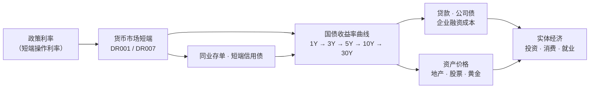
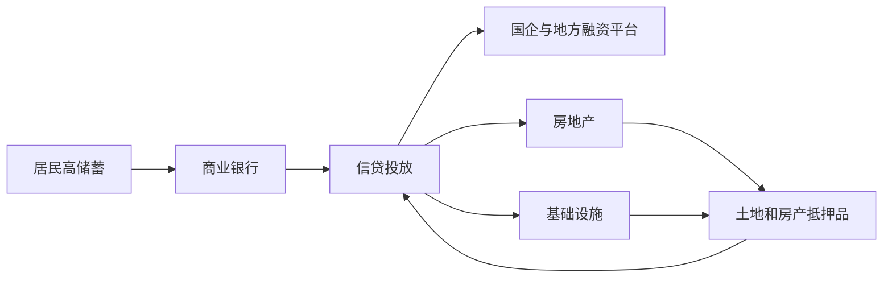
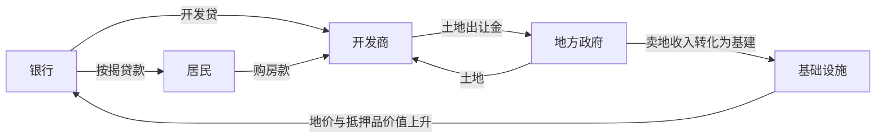
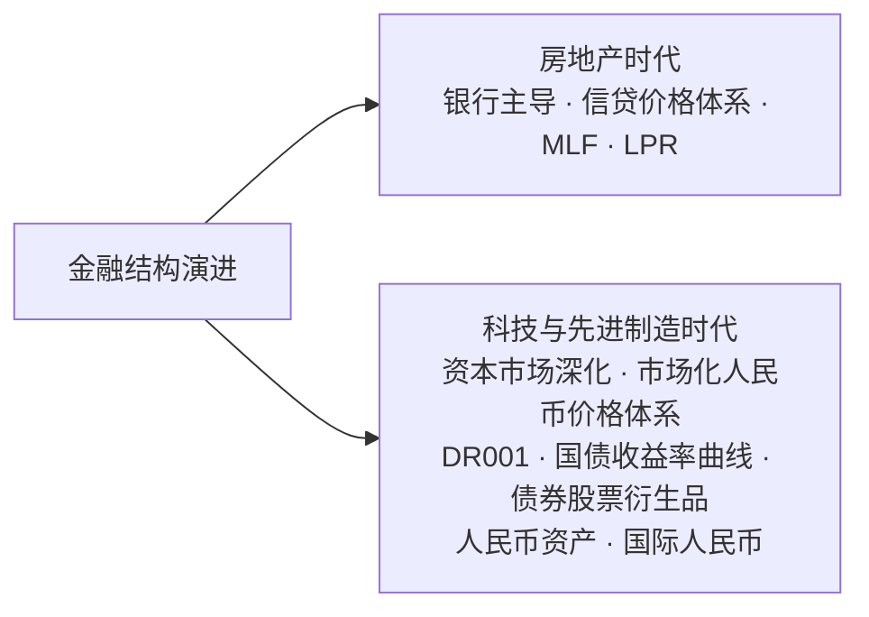
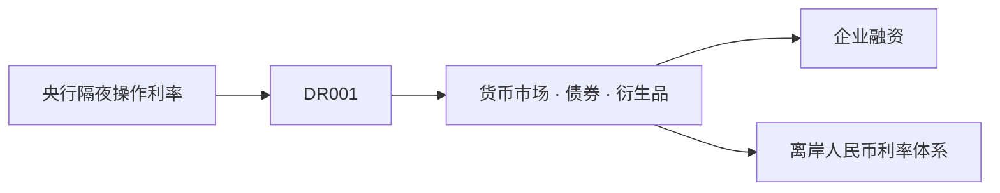
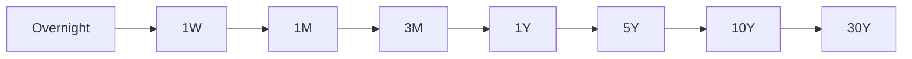
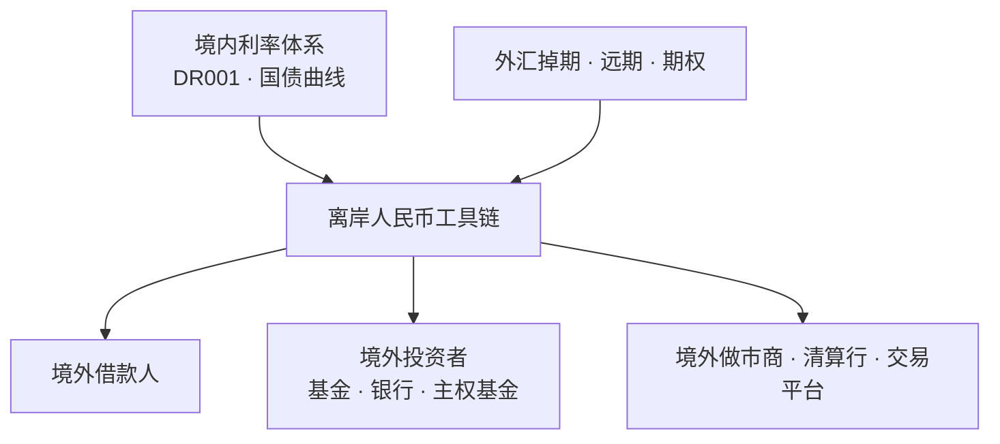

> **说明：** 本文形成于与 AI 的讨论和共同梳理过程，主要用于记录个人思考。文中观点、数据与推演可能存在疏漏，不保证完全正确，也不构成任何投资建议。

2026 年 10 月 19 日，人民银行行长潘功胜在金融街论坛年会上表示，央行将研究适时把公开市场主要操作期限调整为隔夜，并以隔夜回购利率作为主要政策利率。[^pbo1]

这意味着，中国货币政策的短期利率锚将从 7 天期转向隔夜。

这一调整已有铺垫。6 月 17 日，央行预告将增加隔夜逆回购操作，并把临时隔夜正、逆回购利率区间从 70 个基点收窄至 50 个基点；6 月 29 日，首次开展隔夜逆回购。到 10 月，单日操作上限提高至 1 万亿元，并计划从 10 月 21 日至 11 月 2 日连续 9 个工作日操作。10 月 21 日，7 天期逆回购操作量为**零**。[^mkt16]

为什么从 7 天改为隔夜，值得单独讨论？

## 央行在控制什么？

钱的三个价格：

- **利率** = 钱在时间上的价格
- **汇率** = 钱相对于另一种货币的价格
- **资产价格** = 钱相对于股票、房子、黄金的价格

央行没有办法同时精确控制所有价格。现代央行最核心的事情，是影响整个金融体系最底层、最接近无风险的短期资金价格。

### 政策利率的经济学本质

政策利率不是一个行政命令，而是一个**锚**。锚定之后，整条收益率曲线由市场自己长出来：



这条链子里，央行真正在做的只有一件事：让最短端的那个价格稳定在它想要的位置上，其余交给市场。2026 年第一季度中国货币政策执行报告的说法很直白——"发挥中央银行政策利率引导作用，引导隔夜利率在政策利率水平附近运行"[^pbo2]。

这也解释了为什么潘功胜同时在讲另一件事：淡化数量目标，把金融总量更多作为观测性、参考性、预期性指标。**利率框架的核心是价格，不是数量。** 既然目标是价格，那么"这个价格对应哪个期限"就不是一个技术细节，而是框架本身。

### "期限不匹配"具体指什么？

这不是一句抽象的话。回到操作层面：

7 天期逆回购操作利率目前是 1.40%[^mkt1]。这是央行自 2025 年 5 月降息到 1.40% 之后一直保持的水平。央行用这个利率，引导整个货币市场。

但市场资金面的真实短端价格是 DR001（银行间存款类机构以利率债质押的隔夜回购加权利率）。10 月 8 日至 12 日，DR001 均值 1.3117%、DR007 均值 1.3449%，**双双低于 1.40% 的政策利率**[^mkt2]；10 月 12 日 DR001 为 1.2896%，R007 加权利率则升破 1.40%。
于是出现一个微妙的不一致：央行声明的"政策利率"是 7 天的，市场真正盯着的、每天都在波动定价的、已经被交易员当成事实锚点的，是隔夜的。两者的期限不匹配，意味着：

1. 央行的政策信号要经过 7 天这个期限，才能传导到 1 天的资金价格上；
2. 央行的操作工具（7 天逆回购）本身会在市场上产生一个 7 天的期限溢价，而这个溢价要靠市场自己在隔夜端"挤"掉；
3. 更要命的是，当央行想临时调节流动性时，用 7 天工具去做"削峰填谷"注定是钝的——资金今天就该还，工具却锁 7 天。

这也解释了为什么 6 月以来隔夜逆回购操作不断扩容，而 7 天期操作多次归零：操作框架正在向市场实际使用的短端期限靠拢。

## 过去是怎样的：为什么中国的工具箱长这样

要理解"换锚"为什么现在才发生，得先理解中国过去二十年是怎么调控的。

### 高度银行化的传导链

中国过去的金融体系长期是：



所以中国过去高度银行化。央行面对的问题从来不是单纯的"今天隔夜资金价格是多少"，而是：

> 银行有没有足够的中长期资金去支持实体经济？

这才是理解中国货币政策工具箱的钥匙。工具不够用，就得造工具，于是一整套非常有中国特色的工具出现了。

### MLF 到底是什么

先把工具分开：

| 工具 | 全称 | 定位 |
| --- | --- | --- |
| OMO | 公开市场操作（逆回购） | 解决短期流动性，当前 7 天期操作利率 1.40% |
| MLF | 中期借贷便利 | 过去承担中期流动性投放 + 政策利率信号，1 年期 |
| SLF | 常备借贷便利 | 流动性的最后提供者 / 利率走廊上限工具，期限隔夜、7 天、1 个月 |

MLF 是怎么演变的，这条线索特别清楚：

- **2024 年 6 月**，陆家嘴论坛上潘功胜说："未来可考虑明确以央行的某个短期操作利率为主要政策利率，目前看，7 天期逆回购操作利率已基本承担了这个功能。"[^mkt3]
- **2024 年 7 月**，创设临时隔夜正、逆回购工具，操作利率分别为 7 天期逆回购操作利率减 20 个基点和加 50 个基点，区间宽 70 个基点[^mkt4]。同月，7 天期逆回购操作利率从 1.8% 下调到 1.7%。
- **2024 年 8 月**，启动公开市场国债买卖操作，当年 8 月至 12 月累计净买入国债 1 万亿元。
- **2024 年 10 月**，推出买断式逆回购，采用固定数量、利率招标、多重价位中标。
- **2025 年 1 月**，因债券市场供求不平衡暂停国债买卖；2025 年 10 月恢复。
- **2025 年 3 月**，MLF 改为固定数量、利率招标、多重价位中标，**不再有统一的中标利率**，MLF 不再具备统一政策利率锚的功能，其直接价格信号明显淡化，逐步回归 1 年期流动性投放工具定位；MLF 余额也从峰值 7.3 万亿元降至约 4 万亿元[^mkt5]。

一句话：MLF 当年之所以能当政策利率，是因为它同时是"投放资金的工具"和"市场看的价格"。当它退回到纯粹的工具角色，价格的活儿就得有人接——而这个人只能是公开市场操作利率。

### 为什么没有"美国 MLF"？

这里千万不要写成"欧美没有中期流动性工具"，那不严谨。

更严谨的说法是：欧美央行当然也提供期限较长的流动性，但它们不需要像过去的中国这样，让一个类似 MLF 的中期操作利率长期承担主要政策利率锚的角色。

原因在于传导结构不同：

- 欧美金融体系的货币政策传导更依赖**货币市场利率 + 收益率曲线 + 资本市场**；
- 中国过去则更依赖**银行资产负债表 + 信贷投放**。

在欧美的框架里，短端利率天然是核心；在中国的框架里，中期资金的供给能力（银行能不能拿到便宜稳定的中长期负债）才是核心。所以，中国过去更需要一个像 MLF 这样兼顾中期流动性投放和政策信号的工具；欧美虽然同样提供不同期限的央行流动性，却不需要长期让一个类似 MLF 的中期工具承担主要政策利率锚的角色。

**区别不在"有没有中长期流动性工具"，而在"谁承担政策利率锚"。**

这一节讲明白，读者基本就能理解 MLF 为什么近年来会逐渐"淡出政策利率角色"——它不是被砍掉，而是被降级了。

### 土地财政：旧传导方式的发动机

理解 MLF 还要理解中国房地产时代钱是怎么流的：



这张图把三件事串在了一起：**银行同时给开发商和居民加杠杆**（开发贷 + 按揭），**地方政府通过卖地把房地产信用扩张的一部分收入转化成基建**，而**基建投资又反过来抬高地价和抵押品价值**，支撑下一轮信贷扩张。

过去中国最大的资产创造机器是土地和房地产，最大的资金中介是银行。所以货币政策天然围绕这条线运转：

**银行负债 → 银行信贷 → 准备金 → MLF → LPR**

房地产时代结束以后，这套传导方式为什么不够用了？

因为中国未来想发展的产业，和房地产有根本区别：

- **房地产**：有土地、有房子，可以抵押给银行。
- **科技**：最宝贵的是工程师、专利、软件、数据、模型和未来现金流。

**房地产时代需要的是能够把储蓄变成信贷的银行；科技时代更需要能够给风险和未来现金流定价的市场。**

于是金融体系自身也必须改变。而这恰好也是两篇文章真正的隐藏主线——把产业转型、利率市场化、资本市场、科技融资和人民币国际化串成同一个金融结构演进：



**这就把"产业转型"和"利率市场化"连起来了。** 不是先有产业转型才需要利率市场化，也不是央行为了市场化而市场化——是抵押品结构变了，旧的传导引擎转不动了，新的引擎需要一套更市场化的价格体系来润滑。

这就把产业转型和利率市场化连起来了。新的产业结构需要新的融资方式，而新的融资方式需要一套更市场化的价格体系。

当这套价格体系逐渐成熟，它也不必只服务于境内融资。人民币计价资产的全球可投资性，将成为它可以进一步支持的结果之一。

## 为什么"隔夜"才是短端的锚

### 美国：充裕准备金框架

美联储现在不是在"操作利率走廊"，而是在**充裕准备金框架**下直接定价。这四层角色要分清楚：

- **政策目标**：联邦基金利率目标区间 3.75%–4.00%；
- **核心管理利率**：准备金余额利率 IORB 3.90%（2026 年 9 月 17 日起），通过给准备金付息，改变银行持有准备金的机会成本，从而把隔夜利率拉住；
- **市场基准之一**：SOFR（Secured Overnight Financing Rate），反映以美国国债作抵押的隔夜回购融资成本，10 月 19 日报 3.87%；
- **辅助工具**：隔夜逆回购工具 ON RRP（3.75%），以及常备回购便利 SRF（4.0%）和贴现窗口一级信贷（4.0%）。[^mkt13]

严格来说，把 IORB 称为"走廊上沿"并不准确。在 2008 年之前的稀缺准备金模式下，美联储靠**调节准备金数量**把联邦基金利率推上去或压下来，利率走廊的两端是硬边界。2008 年之后框架反转：准备金供给由美联储通过资产负债表主动管理，市场利率由一整套**管理利率**（administered rates）定出，央行不再每天微调准备金数量。纽约联储的官方表述是，充裕准备金使政策利率锚定在管理利率上，而 ON RRP 与常备回购操作用于在利率越界时临时增减流动性。[^mkt14]

BIS 对此的总结更直接：美联储主要通过设定管理利率来实施货币政策，**"IORB rate is the primary tool used to influence overnight interest rates"**[^mkt15]

所以更准确的说法是：IORB 是美联储影响隔夜利率的**主要管理利率**，而不是一条走廊的上沿。

每一个环节都是隔夜的。联邦基金利率本身就是隔夜利率，SOFR 则是隔夜的**有抵押**融资成本——担保品是美国国债[^mkt11]。**不是美联储"特别重视"隔夜，而是它的框架天然长在隔夜上。**

### 欧洲：€STR

欧洲央行的政策利率体系以存款便利利率为核心（2026 年 9 月 16 日为 2.50%，主要再融资操作 2.65%，边际贷款 2.90%），而它对应市场的隔夜基准是 €STR——欧元区银行批发市场的**无抵押**隔夜借款成本[^mkt12]。

这里有一个容易混淆的对照：美国的 SOFR 是有抵押的，欧洲的 €STR 是无抵押的。美国国债回购市场规模庞大，因此 SOFR 天然成为重要的有抵押隔夜基准；€STR 则基于欧元区银行批发无抵押隔夜交易形成。两者选择不同，也反映了美国和欧元区货币市场结构及基准利率改革路径的差异。

### 中国未来



不是中国要变成美国，而是：**只要金融体系越来越市场化，就需要一个真实、连续、可交易的短端价格锚。** 市场化的定价，天然要求这个锚有连续、可交易的成交，而不是行政规定出来的数值。

而且这次换锚不是孤立的。同一场讲话里，潘功胜还宣布了三件事，它们必须放在一起读：

1. **推动贷款利率定价基准改革**：从比较单一地参考 LPR 定价，向更加多元的定价基准转型。财务能力强的企业可与金融机构协商，自主选择 DR001 或 LPR 作为浮动利率贷款的定价基准；债券和金融衍生品的定价，也可考虑把 DR001 作为一个选择。LPR 继续作为小企业、个人贷款的定价基准。
2. **退出金融机构存贷款基准利率**：这些利率自 2015 年 10 月以来长期未做调整，在存贷款定价中实际上已不再发挥作用，目前只剩少数司法领域作为计算利息的依据，将推动这些领域改用市场化利率指标。
3. **扩大 SLF 适用机构范围**：纳入境内外资法人银行，并明确全国性银行适用同样的操作安排，实现对境内存款类金融机构的全覆盖。

第 1 条尤其关键。DR001 正由央行重点调控的货币市场利率，进一步走向贷款、债券和衍生品的定价参考。这不是“DR001 与 LPR 双锚”，而是从单一贷款基准走向分层、多元的利率基准体系：DR001 负责短端资金价格，LPR 继续服务于小企业和个人贷款定价。

### 换锚不等于降息

这一点必须说清楚，否则很容易被误读。

当前隔夜逆回购的操作利率，央行**尚未公布**。按市场普遍的测算，隔夜操作利率大概率低于 1.40%，但两者的差属于正常的期限溢价，并不意味央行主动降息[^mkt6]。

而且时间表也未定。潘功胜的原话是"研究**择机**"，并没有给日期。东北证券固收首席孟万林复盘近两年央行的"择机"表述，从提及到落地历时 4 到 6 个月，据此预计本次大概率落在 2027 年一季度[^mkt7]。

框架改革和货币政策松紧是两件事。框架改的是"用哪把尺子"，松紧改的是"尺子刻在哪"。目前尺子还没换，刻度也没动。

## 收益率曲线：经济给时间和风险定价的尺子

如果只到这里，"隔夜换锚"看起来像是技术性的框架调整。再往下一层，它触及的是更本质的东西。

一个成熟金融体系最重要的产物，就是一条连续、完整、可交易的收益率曲线：



它实际上是整个经济给**时间**和**风险**定价的尺子。任何一笔融资、任何一笔资产配置，最终都要在这条尺子上找位置。

再进一步，任何一个融资利率都可以拆开：

```text
企业融资利率 ≈ 无风险利率 + 期限溢价 + 信用风险 + 流动性溢价
```

短端无风险利率主要受当前政策利率影响；中长端利率则取决于市场对未来政策利率、通胀和经济增长的预期，并包含期限溢价。信用风险和流动性溢价再叠加其上。

那么现在的中国曲线是什么形状？中债国债收益率曲线（2026 年 10 月 20 日）[^mkt17]：

| 期限 | 1 年 | 3 年 | 5 年 | 7 年 | 10 年 | 30 年 |
| --- | --- | --- | --- | --- | --- | --- |
| 收益率（%） | 1.18 | 1.26 | 1.35 | 1.44 | 1.64 | 2.05 |

曲线是正斜率的，但非常平。10 年减 1 年只有 46 个基点。对照美国：10 月 19 日美债 10 年期收益率约 5.14%[^mkt8]，中债 10 年期 1.64%，**倒挂约 350 个基点**[^mkt18]。

这个倒挂值得多说两句，因为它正好演示了"利率"和"汇率"可以脱钩。按过去的经验，300 个基点的中美利差倒挂，人民币早就扛不住了。但 2026 年发生了什么？

人民币不但没有跟着贬值，反而创下了 2005 年汇改以来对美元的累计升值（名义有效汇率升值超 50%，实际有效汇率升值 35%），2025 年以来对美元累计升值约 9%；与此同时，银行代客结售汇连续维持巨额顺差[^mkt9][^mkt10]。

至少在这一阶段，贸易和跨境收支对人民币汇率的支撑，明显抵消了中美利差带来的贬值压力。过去那种"利差扩大必然对应人民币明显贬值"的简单经验关系，正在失效。

这可能意味着，人民币定价中来自实体贸易现金流的权重正在上升。但这并不代表利差已经失效，只是它在当前阶段被贸易现金流、资本流动和政策预期等因素部分覆盖。

回到曲线。换锚之所以"不是一件无聊的小事"，因为真正要建设的是**从隔夜一直延伸到几十年的人民币价格体系**。短端定不下来，曲线就没有可靠的起点；曲线不可靠，长端资产就无从定价。

## 这条人民币收益率曲线只给中国人用吗？

假设一下这些场景：

- 印尼企业借人民币
- 沙特企业发人民币债
- 欧洲公司持有人民币
- 新加坡基金买人民币债券

他们各自需要的是：



每一个环节都要求相互连接的价格体系：从隔夜、隔夜回购，到中长端人民币债券，再到人民币掉期和外汇远期。离岸市场并非没有短端价格，CNH HIBOR、离岸回购和掉期市场都提供短端定价。真正缺少的，是一个与在岸政策利率和国债曲线稳定连接、具有足够深度的离岸融资体系。否则，跨境期限套利和风险管理就难以闭合，人民币也更容易停留在过手资金阶段。

所以，国内的利率市场化和人民币国际化，在这里第一次发生了连接。

但要说清楚因果关系，不能倒过来：

> 不是"换隔夜就是为了人民币国际化"。

而应该说：

> 一套高效、透明、市场化的人民币利率体系，本身就是人民币进一步承担国际融资与投资功能所需要的基础设施。

## 从"钱的价格"走向"钱的边界"

如果越来越多外国人开始使用、持有甚至借入人民币，那么中国接下来面对的，就不再只是"怎么给人民币定价"的问题。

那是一个更困难的问题：**人民币究竟准备在世界金融体系里扮演什么角色？**

从"钱的价格"到"钱的边界"——这正是下一篇文章要回答的。

## 数据附录

本文正文只保留最能解释结构变化的数字，其余量级集中列在这里，便于核查。

| 指标 | 数值 | 时点 | 来源 |
| --- | --- | --- | --- |
| 7 天期逆回购操作利率 | 1.40%（2025 年 5 月降息后未变） | 截至 2026-10 | 人民银行 |
| DR001 / DR007 周均 | 1.3117% / 1.3449%，均低于政策利率 | 2026-10-08 至 12 | 中国货币网 |
| 临时隔夜正 / 逆回购利率区间 | 7 天 -20bp / +50bp（70bp）→ ±25bp（50bp） | 2024-07 → 2026-06 | 人民银行 |
| 隔夜逆回购操作量上限 | 3000 亿 → 6000 亿 → 10000 亿元 | 2026-06 → 10 | 人民银行 |
| 隔夜逆回购操作天数 | 每月 2 天 → 4 天 → 8 天；已安排 10/21—11/02 连续 9 个工作日 | 2026-06 → 11 | 人民银行 |
| MLF 余额 | 峰值 7.3 万亿元 → 约 4 万亿元 | 2024-07 → 2025-03 | 人民银行 |
| 央行国债买卖 | 2024-08 至 12 净买入 1 万亿元；2025-01 暂停，2025-10 恢复 | 2024—2025 | 人民银行 |
| 中债国债收益率曲线 | 1 年 1.18% / 3 年 1.26% / 5 年 1.35% / 7 年 1.44% / 10 年 1.64% / 30 年 2.05% | 2026-10-20 | 中债估值中心 |
| 美债 10 年期收益率 | 约 5.14% | 2026-10-19 | 美国国债市场 |
| 中美 10 年期利差 | 倒挂约 350 个基点 | 2026-10 | 中债 / 美债 |
| 美联储目标区间 / IORB | 3.75%–4.00% / 3.90% | 2026-09-17 起 | FOMC |
| 美联储 ON RRP / SRF / 一级信贷 | 3.75% / 4.0% / 4.0% | 2026-09-17 起 | FOMC 实施决定 |
| SOFR | 3.87% | 2026-10-19 | 纽约联储 |
| 欧洲央行存款便利 / MRO / 边际贷款 | 2.50% / 2.65% / 2.90% | 2026-09-16 | 欧洲央行 |
| LPR（1 年 / 5 年以上） | 3.00% / 3.50% | 2026-10-20 | 全国银行间同业拆借中心 |
| 人民币对美元累计升值 | 2005 年汇改以来 23%；名义有效汇率 >50%，实际有效汇率 35% | 2026-10 | 人民银行 |
| 银行代客结售汇顺差 | 2026 年 1—8 月 3976 亿美元（2005 年以来同期最高）；2026 H1 2712 亿美元 | 2026 | 外汇局 |

---

[^pbo1]: 中国人民银行行长潘功胜在 2026 金融街论坛年会上的主题演讲《关于当前市场关注若干问题的思考》，2026-10-19。
[^pbo2]: 中国人民银行《2026 年第一季度中国货币政策执行报告》。
[^mkt1]: 公开市场 7 天期逆回购操作利率自 2025 年 5 月起维持 1.40%，至 2026 年 10 月未变。
[^mkt2]: 中国货币网数据，2026 年 10 月 8 日至 12 日。
[^mkt3]: 2024 年陆家嘴论坛（第十五届）主题演讲。
[^mkt4]: 中国人民银行创设临时隔夜正、逆回购操作，2024 年 7 月。
[^mkt5]: 《2025 年 3 月中期借贷便利招标公告》及同期市场报道。
[^mkt6]: 申万宏源固收首席黄伟平：当前 7 天期逆回购操作利率为 1.4%，隔夜逆回购操作利率大概率低于 1.4%，两者之差属于正常期限溢价。
[^mkt7]: 东北证券固收首席孟万林对"择机"表述历史落地周期的复盘。
[^mkt8]: 美国 10 年期国债收益率，2026 年 10 月 19 日。
[^mkt9]: 中国人民银行《关于人民币汇率的政策立场》，2026 年 10 月 8 日；工银国际首席经济学家程实分析，2026 年 1—8 月银行代客结售汇顺差 3976 亿美元。
[^mkt10]: 国家外汇管理局《2026 年上半年外汇收支数据情况》：上半年银行结售汇顺差 2712 亿美元，非银行部门跨境资金净流入 2472 亿美元。
[^mkt11]: 纽约联储 SOFR 官方定义："The Secured Overnight Financing Rate (SOFR) is a broad measure of the cost of borrowing cash overnight collateralized by Treasury securities."；数值取自纽约联储每日发布，2026 年 10 月 19 日为 3.87%。
[^mkt12]: 欧洲央行 €STR 官方说明："The €STR reflects the wholesale euro unsecured overnight borrowing costs of banks located in the euro area."
[^mkt13]: 美联储 2026 年 9 月 16 日 FOMC 决议《货币政策实施决定》：IORB 上调至 3.90%（9 月 17 日生效）；常备隔夜回购操作利率 4.0%；隔夜逆回购报价利率 3.75%，单一交易对手每日限额 1600 亿美元；一级信贷利率上调至 4.0%。准备金率要求自 2020 年 3 月 26 日起已降至零并维持至今。
[^mkt14]: 纽约联储《2026 年 6 月 Crane 货币基金研讨会》材料："Ample reserves keep the policy rate, the federal funds rate, anchored to administered rates. ... ON RRP and Standing Repo operations (SRPs) are responsive to changes in money market rates and temporarily add or reduce liquidity as needed."
[^mkt15]: 国际清算银行《Markets Committee compendium — Currency area overviews》对美国货币政策实施框架的描述："The IORB rate is the primary tool used to influence overnight interest rates."
[^mkt16]: 中国人民银行公开市场业务交易公告，2026-10-21：当日 7 天期逆回购操作量为零，同时开展 800 亿元隔夜逆回购操作。
[^mkt17]: 中债估值中心《国债及其他债券收益率曲线》，2026-10-20。
[^mkt18]: 9 月 9 日中美 10 年期利差曾达 317 个基点，创彭博 2002 年有记录以来最大值。
