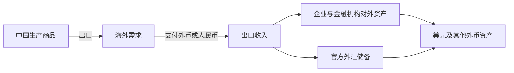
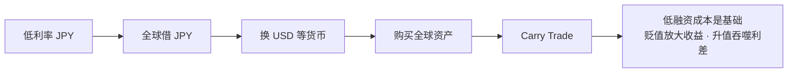
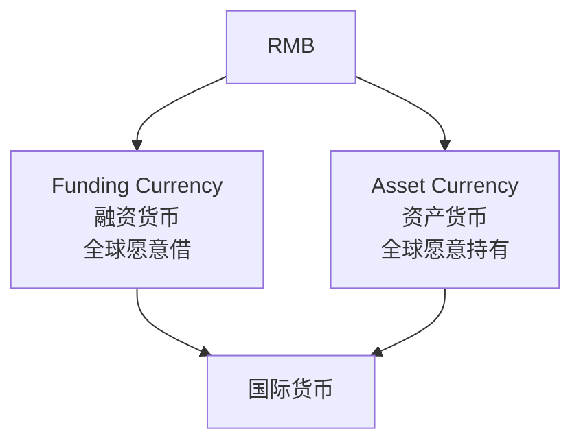
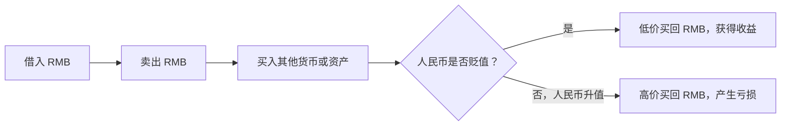
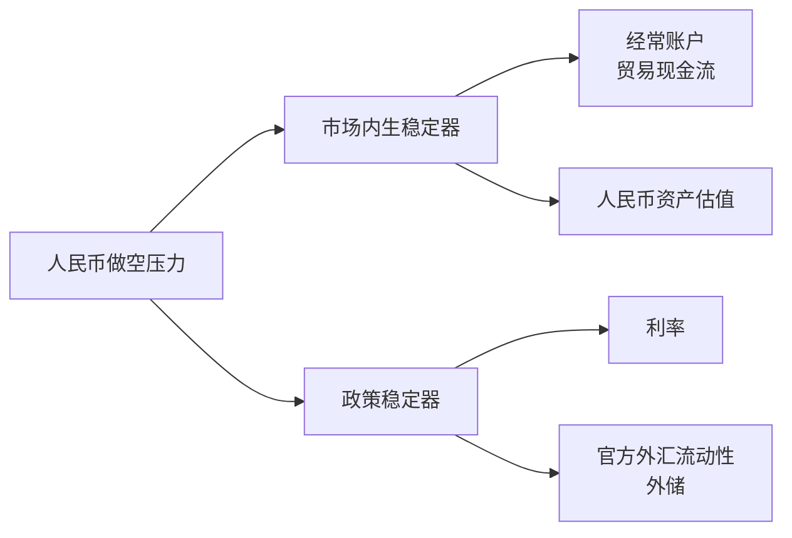
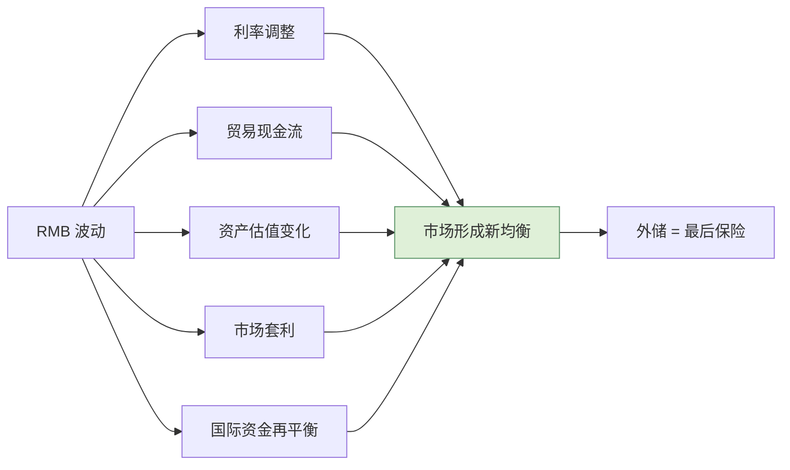
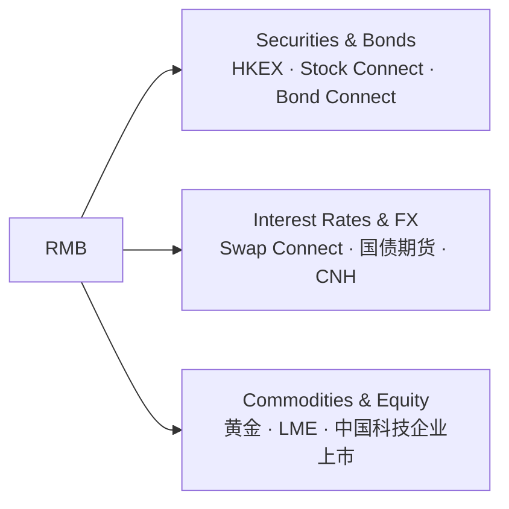
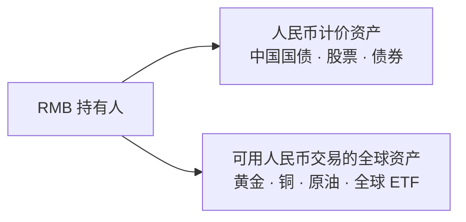

> **说明：** 本文形成于作者与 AI 的讨论和共同梳理过程，主要用于记录个人思考。文中观点、数据与推演可能存在疏漏，不保证完全正确，也不构成任何投资建议。

上一篇讲的是中国怎么给自己的钱定价。这一篇要讲一个更大的问题：**人民币打算在世界金融体系里扮演什么角色？**

## 人民币为什么要国际化？

先看一个循环。这是过去二十年中国经济的基本节奏：



这里存在一个有意思的不对称：**我们生产真实商品，最终积累了大量由外国发行的金融资产。**

2026 年上半年，我国货物贸易进出口 25.47 万亿元，同比增长 16.9%，规模历史同期首超 25 万亿元（数据见附录）。国际收支口径下，上半年经常账户顺差 3780 亿美元，与 GDP 的比值保持稳定。

问题不在于顺差本身。问题在于：这些顺差最终要以什么资产的形式存在。

如果一个全球最大的生产国长期只能通过另一个消费国的货币体系储存自己的盈余，这套结构会永远稳定吗？

人民币国际化真正要改变的，是这个：

> 中国是否能够逐渐用自己的货币进行贸易、融资、投资和资产定价。

## 储蓄输出国与资本吸收国

为了方便理解，我把它简化成"**生产 / 储蓄输出型经济体**"和"**消费 / 资本吸收型经济体**"两组特征。

但要先说清楚：这是分析框架，不是国别标签。美国本身就是全球最重要的生产国之一，在能源、科技和服务出口上举足轻重；中国同样有规模可观的消费市场和进口需求。真正的分野不在"谁生产、谁消费"，而在**一国是全球储蓄的净输出方，还是净吸收方**。

### 资本吸收国

以美国为例，特点很清晰：

- 国内吸收能力较强，通常表现为储蓄相对投资不足
- 资本市场深，产权清晰
- 经常账户可以长期逆差
- 长期吸收全球净资本流入
- 本币是储备资产

### 储蓄输出国

中国、日本，以及部分出口型经济体具备更多这些特征：

- 生产能力强
- 储蓄率高
- 贸易顺差
- 对外积累资产

这两类经济体之间存在一种隐形的"货币分工"：**一方输出商品、积累别国货币；另一方输出货币、吸收别国的商品和储蓄。**

美元体系能够长期运转，一个重要条件是美国拥有足够深的资本市场，并且长期向全球提供大量美元计价的安全资产和风险资产，从而吸收全球储蓄。而人民币体系目前还没有这个位置——中国在输出商品，但输出的资产主要以美元、欧元计价。

**美国不只是输出美元，而是输出资产负债表。** 真正支撑美元国际地位的，不只是美元本身，而是美元背后的金融资产供给。

人民币国际化要解决的就是这个不对称：**让跨境贸易产生的人民币不必立即兑换成美元，而能够继续留在人民币体系内，用于融资、投资和资产配置。**

## 日元的生态位

国际货币的生态位不是靠"宣布"得到的，而是靠交易行为长出来的。日元提供了一个现成的样本。

日元在国际金融体系里的角色之一：



于是日元成为**国际融资货币**。全世界的机构用极低的成本借日元，换成美元去买更高收益的资产。

这笔生意的收益结构其实很简单：

```text
Carry Return ≈ Interest Differential + FX Change
```

对借日元的人来说：

- **日元不动**：赚利差；
- **日元贬值**：利差之外再赚一段汇率；
- **日元升值**：可能迅速吞噬全部利差。

所以正确的说法不是"日元贬值本身是套息交易必须存在的收益"，而是：**低融资成本是套息交易成立的基础，日元贬值会进一步放大收益，而最大的风险恰恰是日元突然升值。** 2024 年 8 月的那一轮平仓潮，正是日元在短时间内急升、套息盘集体反手造成的。

这对日本有什么好处？又有什么代价？

**好处很直接**：日本可以靠提供廉价资金在全球范围内获得影响力，不必自己制造需求，资金自然往外流。

**代价也很直接**：日元汇率越来越受到全球杠杆、海外资产回报和美日利差的共同驱动，日本国内政策很难单独决定其走势。2026 年这一轮演得非常清楚：

- 6 月，日本央行把关键贷款利率上调 25 个基点至 1%，为 1995 年以来最高；[^mkt3]
- 7 月至 8 月，日元一度贬至 164 附近，创 1986 年以来最弱；
- 7 月 30 日至 8 月 26 日，美日当局动用 15.4 万亿日元（约 964 亿美元）支撑日元，创单月干预纪录，其中 7 月 30 日、31 日是 1998 年以来美日首次联合干预；
- 然而 8 月 31 日，日元仍再度跌破 160；
- 干预之后，杠杆基金的日元净空头并未消失，只是从"赌日元贬值"的投机盘，转成"借日元买海外资产"的实需盘——截至 8 月 15 日止的两周，日本投资人净买进超过 5 万亿日元的海外股票及长期债券，而前两周还是净卖出 3000 亿日元；[^mkt4]
- 截至 2026 年 3 月，跨境日元借贷——套息交易的代表——已升至创纪录的 360 万亿日元（约 2.35 万亿美元）。[^mkt5]

**一次加息未必足以结束套息，单次干预也难以逆转由利差和资本流动驱动的长期趋势。** 只要资金成本仍显著低于海外回报，套息交易就可能继续。国际货币的生态位，本质上是"别人愿意用你的钱"这个行为的沉淀物，而不是任何一项政策的结果。

顺带纠正一个常见的直觉：日元贬值抬高的是进口品以日元计价的价格，方向上是输入性**通胀**而不是输入性通缩。日本央行 2026 年 6 月加息时，正是把能源与进口价格压力列为通胀风险之一。[^mkt11]

那人民币可以借鉴日元什么？

- 亚洲融资货币
- 稳定的低成本资金来源
- 深厚的离岸市场
- 完整的 FX / Swap / 债券市场

但不能仅仅复制什么？

**不能只有"大家都愿意借人民币"。**

还必须做到：**大家也愿意持有人民币资产。**

## 融资货币和资产货币必须同时存在

这是整个逻辑里最关键的一环。本文所说的“资产货币”不是严格的官方分类，而是指一种被全球投资者用于储备和长期资产配置的货币。



融资货币和资产货币是**两种完全不同的需求**：

| | 融资货币 | 资产货币 |
| --- | --- | --- |
| 全球为什么持有 | 为了低成本融资、为了交易便利 | 为了避险、储备、资产配置 |
| 关键条件 | 利差、资金可得性 | 深度、流动性、法律可执行性、长期回报 |
| 一旦缺失 | 借不到钱 | 不敢把钱存下来 |
| 谁先成立 | 更容易（靠利差即可启动） | 更难（需要长期的资产供给） |

现实是：**融资货币可以靠利差快速启动，资产货币只能靠时间慢慢积累。** 日元非常成功地占据了全球融资货币的生态位，但与美元相比，其作为全球储备资产和跨境财富储存载体的地位明显弱得多——它始终更多是"别人手里的燃料"，而不是"别人财富的存放地"。

这正是人民币接下来要过的关。

## 人民币计价资产为什么如此重要？

外国人拿到人民币以后，必须有东西可买：

- 中国国债
- 政策性金融债
- 企业债
- 股票
- ETF
- REITs
- 黄金
- 商品
- 衍生品

人民币国际化不能只有 **RMB Payment**，必须进一步形成 **RMB Assets**。

那么现在到哪一步了？《2026 年人民币国际化报告》（2026 年 9 月 24 日发布）给出了四个最能说明结构变化的数字：

- **42.4 万亿元**——2026 年 1—6 月银行代客人民币跨境收付金额，同比增长 21.4%（2025 年全年为 70.6 万亿元，增长 10.1%）；
- **29.1%**——同期货物贸易项下人民币结算占比，同比上升 1 个百分点；
- **11.3 万亿元**——截至 2026 年 6 月末，境外主体持有境内人民币股票、债券、贷款及存款等金融资产余额合计，同比增长 9.2%；[^mkt6]
- **1.8 万亿元**——2026 年一季度末，主要离岸市场人民币存款余额；同期离岸人民币债券发行 8961 亿元，同比增长 94.4%。[^mkt7]

其余的量级（熊猫债、CIPS 参与机构、境外持债规模、储备货币份额等）放在文末数据附录。

再看几个更有意思的结构性变化。

**外资发行人在熊猫债市场首次超过中资背景发行人。** 2026 年上半年，外资发行人募资规模占熊猫债市场总募资规模的 54%，其中募集资金拟用于境外的规模 587 亿元，占外资募资规模的 68%。这说明熊猫债对境外机构而言，已经从"试探性融资"变成了"战略性资金安排"。

**资金流向发生了质变。** 2026 年 6 月，央行、印尼央行、香港金管局签署合作备忘录，建立印尼盾与离岸人民币双边交易的合作框架。同月，央行创设**境外央行回购工具**，支持境外央行或货币当局、国际金融组织、主权财富基金通过债券回购从人民银行获取人民币流动性，并拟将外资人民币清算行纳入支持对象。到了 2026 年 8 月，人民银行已与 32 个国家或地区的央行签署双边本币互换协议。[^mkt10]

这些动作连起来看，指向同一个方向：**人民币不再只是“收进来”，而是要让境外主体在离岸市场也能获得、能融资、能投资、能对冲。**

## 但是一旦允许全世界借人民币，一个危险的问题出现了



一种不能承受别人做空的货币，不可能真正成为国际货币。

这是"融资货币"这个身份的固有代价。日元承受了几十年这种压力，靠的是深度和惯例——真到了极端情形，做空日元的对手盘面对的是全球最深的日元市场、最大的国际债权国资产负债表，以及随时可能出现的官方干预。人民币目前还不具备这个厚度。

所以问题变成了：**如果人民币可以被自由做空，什么力量会形成反向约束？**

这些力量可以分为两类：**市场内生稳定器**和**政策稳定器**。前者不需要任何人刻意设计，是市场结构本身的结果；后者才是政策工具。



### 市场内生稳定器

#### 经常账户 / 贸易现金流

真实商品不断出口：


所以贸易顺差并不仅仅是"赚外汇"。它意味着：**中国拥有持续创造国际购买力的能力。** 2026 年上半年，货物贸易人民币跨境收付占比 29.1%；银行结售汇顺差 2712 亿美元，非银行部门跨境资金净流入 2472 亿美元。真实商品出口是人民币需求最顽固的来源。

#### 人民币资产估值

如果人民币下跌，优质中国资产就变便宜：


前提当然是：中国必须存在外国人真正愿意长期持有的资产。11.3 万亿元说明人民币资产已经形成一定的境外持有基础；它能否在汇率和资产价格下跌时形成反向资金流，还取决于资产回报、流动性和投资者信心。**存量规模不等于边际稳定能力。**

### 政策稳定器

#### 利率

必要情况下短端利率可以调整，增加做空人民币的融资成本（funding cost）。

这一层直接接上了上一篇的主题。**隔夜操作提高了央行管理短端人民币流动性的精细度。** 理论上，这也意味着在市场压力出现时，央行能更直接地影响人民币最短端融资条件。不过，汇率稳定仍然取决于外汇市场、跨境资本流动和宏观审慎政策等一整套工具——把"换锚"直接换算成"抗做空能力"，是过度推演。

#### 官方外汇流动性 / 外储

最后才是：央行直接用外汇储备提供外币流动性或稳定市场。

这是最后一道保险，但它应该是最后一道，而不是日常操作。

## 人民币国际化真正有趣的一点

我想强调的是这一层，而不是前面四层。

**旧思维是这样一个循环：**


**这种机制无法无限持续。** 因为它本质上是"用外储去托一个不想贬值的汇率"，而外储是有限的。

**更成熟的体系应该是这样：**



而不再是"人民币每天的价格维护基金"。

**这个转变可以从国际收支和资产负债表中观察，但不能只看一个数字下结论。** 2026 年 6 月末，我国对外资产 12.2 万亿美元，较 2025 年末增长 3.3%；对外负债 8.4 万亿美元，增长 8.3%；对外净资产 3.8 万亿美元[^mkt2]。这些数据说明中国整体对外资产负债表仍保持净资产状态，经常账户顺差也在继续积累。但是否动用外储，还需直接观察储备资产变化，不能仅由净国际投资头寸推断。

更重要的是汇率本身的行为。2026 年，美元指数和美债收益率较快上行，非美货币普遍贬值，但人民币对美元总体延续升值走势——2005 年汇改以来累计升值 23%，2025 年以来累计升值约 9%。[^mkt9]

至少在这一阶段，贸易和跨境收支对人民币汇率的支撑，明显抵消了中美利差带来的贬值压力。这说明当前人民币稳定并不主要依赖日常消耗外储。外储仍然重要，但其角色更接近应对极端冲击的最后保险，而不是维持某个固定汇率水平的日常工具。

> 尽量不消耗外汇储备，同时保持国内经济政策的自主性和稳定性。

## 香港地位

人民币既要国际化，又不能一下把境内资本账户完全放开，怎么办？

香港就是这个问题的答案。


所以香港不只是中国的一个股票市场。

**它是人民币国际化的离岸压力测试场和全球接口。**

香港的价值之一，在于让人民币在资本账户尚未完全开放的条件下，先在离岸市场接受更充分的交易、融资、做空、套利和价格发现。这样既可以扩大人民币的国际使用，又在一定程度上保留在岸金融体系的政策空间。

**香港不是简单地替上海完成国际化，而是在岸和全球之间提供一个可交易、可观察、可管理的中间层。**

香港当前的体量也在印证这个角色。截至 2026 年 7 月底，香港人民币存款 11254 亿元，人民币贷款已超 1 万亿元，两者非常接近——香港金管局助理总裁朱海斌指出，随着人民币融资业务发展，资金来源和成本管理正成为需要关注的问题。[^mkt8]

存贷款规模逐渐接近，至少说明香港离岸人民币市场已经不再只是一个被动沉淀人民币存款的"资金池"，融资需求的重要性正在明显上升。至于是否形成真正意义上的自循环，还要进一步观察离岸存款、债券、回购、掉期和做市流动性的共同发展。

## 香港最终需要构建什么？



港交所已于 2026 年 8 月正式推出**五年期中国国债期货**，为离岸人民币利率风险管理补上了一项重要的标准化场内工具。香港首个五年规划也提出强化离岸人民币业务枢纽功能，包括增强流动性支持、扩阔离岸人民币产品供应。

而在商品端，港交所正筹备人民币黄金期货，香港黄金中央清算及结算系统计划于 2027 年第一季度正式启用，建立集中对手方清算机制。

所以香港最终卖的不是港股。

**香港要卖的，不只是港股，而是一整套能够更自由地使用人民币进行融资、投资和风险管理的金融市场。**

### 黄金

外国人为什么愿意持有离岸人民币生态？

因为人民币不应该只能换回中国存款。它可以：



这是一个“资产货币”必须具备的完整性：**人民币持有人必须拥有足够丰富的人民币计价资产，以及能够直接用人民币交易和对冲的全球资产。** 如果离岸人民币只能用于存款、结算，或者最终兑换成美元，它就仍然更像一种过手货币。只有当人民币可以方便地配置债券、股票、黄金、商品和衍生品，它才更接近完整的资产货币。

"上海金"集中定价合约自 2016 年 4 月上线至 2026 年 4 月末，累计成交量 11228.68 吨，累计成交金额 4.49 万亿元——中国自己的黄金定价中心已经在运转。剩下的，是把它接到离岸去。

## 人民币国际化的机会是什么？

分三层来看：

### 第一层：金融基础设施

交易所、银行、清算、券商、资管。

也就是我们的**卖铲人**。这一层的逻辑很朴素：只要人民币跨境使用的规模在增长，无论谁赢，这层的基础设施都要建，而且要建得更多。

### 第二层：人民币核心资产

外国资金真正愿意长期配置的东西：

- 高 ROIC 企业
- 高 FCF 企业
- 全球竞争力企业
- 高分红企业

### 第三层：中国科技生产率资产

互联网平台、半导体、AI、机器人、创新药、智能汽车、先进制造。

但必须强调：**人民币国际化只提供估值环境，企业盈利能力才决定长期回报。** 货币国际化可以让估值折价收窄一点，但没法让一家不赚钱的公司变成好投资。

## 最大的风险：中国会不会走向日本化？

真正的风险不是"人民币成为融资货币"。

真正的风险是这个链条：


所以真正需要避免的是：**融资货币成功了，资产货币却失败了。**

现在摆在人民币面前的选择是：

- 如果只是靠低利率吸引全球来借人民币，那么得到的只是一个"更大的日元"——一个靠利差支撑的、汇率单边承压的融资货币。**日本过去数十年的经验说明：融资货币可以长期存在，但仅靠融资属性，并不足以让一种货币成为全球核心的财富储存货币。**
- 如果能在产业升级的同时，产出真正值得全球长期持有的资产，那么得到的才是一个国际货币。

所以人民币国际化最终取决于中国能不能创造"值得持有的资产"。

> 国际货币的地位不是印出来的，而是全球企业、金融机构和投资者在一次次交易、融资和资产配置中投票形成的。

所以，美元背后不只是美联储。还有美国国债、美股、科技公司、全球资本市场。

人民币未来也一样。

**最终竞争不是 USD vs RMB，而是 USD Assets vs RMB Assets。**

## 那普通人应该怎么办？

"持有人民币" ≠ "持有人民币资产"。

- **现金**：是人民币本身。
- **股票**：是中国企业的生产能力。
- **黄金**：是非主权资产。
- **全球资产**：是其他经济体生产能力。

于是家庭资产负债表可以逐渐从过去的“房子 + 存款”，向更分散的“现金 + 中国优质股权 + 全球资产 + 黄金”演化。这不是一个固定比例的资产配置建议；现金需求、收入稳定性、投资期限和风险承受能力，仍然决定每个人适合的组合。

重点并不是预测美元人民币下一站是 6.5 还是 8。

**而是问：未来十年，我拥有的到底是什么？**

## 数据附录

本文正文只保留最能解释结构变化的数字，其余量级集中列在这里，便于核查。

| 指标 | 数值 | 时点 | 来源 |
| --- | --- | --- | --- |
| 货物贸易进出口 | 25.47 万亿元，同比 +16.9% | 2026 H1 | 海关总署 |
| 出口 / 进口 | 14.73 / 10.74 万亿元 | 2026 H1 | 海关总署 |
| 经常账户顺差 | 3780 亿美元 | 2026 H1 | 外汇局 |
| 对外资产 / 负债 / 净资产 | 12.2 / 8.4 / 3.8 万亿美元 | 2026-06 | 外汇局 |
| 银行代客人民币跨境收付 | 70.6 万亿元（2025 全年）／42.4 万亿元（2026 H1） | 2025、2026 H1 | 人民银行 |
| 货物贸易人民币结算占比 | 28.7% → 29.1% | 2025 → 2026 H1 | 人民银行 |
| 境外主体持有境内人民币金融资产 | 11.3 万亿元，同比 +9.2% | 2026-06 | 人民银行 |
| 境外机构持有银行间市场债券 | 3.19 万亿元，占总托管量 1.7% | 2026-09 | 人民银行上海总部 |
| 境外机构入市主体 | 1209 家 | 2026-09 | 人民银行上海总部 |
| COFER 人民币储备规模 | 2601 亿美元 | 2026 Q1 | IMF |
| 纳入人民币储备的国家 / 地区 | 80 多个 | 2026-09 | 人民银行 |
| 熊猫债累计发行 | 超 1.3 万亿元，覆盖五大洲 26 个国家和地区 | 2026-06 | 人民银行 |
| 熊猫债发行额 | 1600.3 亿元（+70%）／年内超 2400 亿元、135 只 | 2026 H1、2026-09 | 人民银行、新华社《经济参考报》 |
| 外资发行人占熊猫债募资 | 54%（首超中资背景） | 2026 H1 | 外汇局 |
| 离岸人民币债券发行 | 8961 亿元，同比 +94.4% | 2026 H1 | 人民银行 |
| 主要离岸市场人民币存款 | 约 1.8 万亿元 | 2026 Q1 | 人民银行 |
| CIPS 直接 / 间接参与者 | 214 家 / 1651 家，覆盖 192 个国家和地区 | 2026-09 | CIPS |
| 香港人民币存款 / 贷款 | 11254 亿元 / 超 1 万亿元 | 2026-07 | 香港金管局 |
| 外汇储备 | 34003 亿美元，连续 6 个月在 3.4 万亿美元上方 | 2026-09 | 外汇局 |
| 双边本币互换协议 | 32 个国家 / 地区央行 | 截至 2026-08 | 人民银行 |
| 上海金累计成交 | 11228.68 吨 / 4.49 万亿元 | 2016-04 至 2026-04 | 上海黄金交易所 |


从 7 天到隔夜，表面上只是中国重新定义了最短期限的资金价格。

但如果把利率市场化、人民币跨境使用、香港离岸市场、中国资本市场改革和科技产业升级放在一起看，真正正在发生的，也许是另一件更大的事情：**我们正在尝试让人民币从"中国的钱"，逐渐变成一种别人愿意使用、愿意借、也愿意长期储存财富的货币。**

而到了那个时候，真正重要的问题已经不是人民币值多少钱，而是谁拥有人民币计价的优质资产。

---

[^mkt2]: 国家外汇管理局《2026 年上半年中国国际收支报告》及 2026 年二季度国际收支平衡表。
[^mkt3]: 日本央行 2026 年 6 月议息会议：关键贷款利率上调 25 个基点至 1%，为 1995 年以来最高。
[^mkt4]: 日本财务省数据及 CFTC 持仓报告，2026 年 7—8 月。
[^mkt5]: 杰富瑞基于 BIS 数据的分析，截至 2026 年 3 月。
[^mkt6]: 中国人民银行《2026 年人民币国际化报告》，2026 年 9 月 24 日发布。
[^mkt7]: 中国人民银行《2026 年人民币国际化报告》。
[^mkt8]: 香港金融管理局助理总裁朱海斌在 2026 清华五道口首席经济学家论坛的讲话。
[^mkt9]: 中国人民银行《关于人民币汇率的政策立场》，2026 年 10 月 8 日。
[^mkt10]: 印尼盾与离岸人民币双边交易合作备忘录（2026 年 6 月）、境外央行回购工具创设（2026 年 6 月），及截至 2026 年 8 月的双边本币互换协议签署情况。
[^mkt11]: 日本央行 2026 年 6 月议息会议指出通胀压力正在加大；同期市场分析认为，日元疲软进一步推升了日本作为能源与食品净进口国面临的物价压力。
